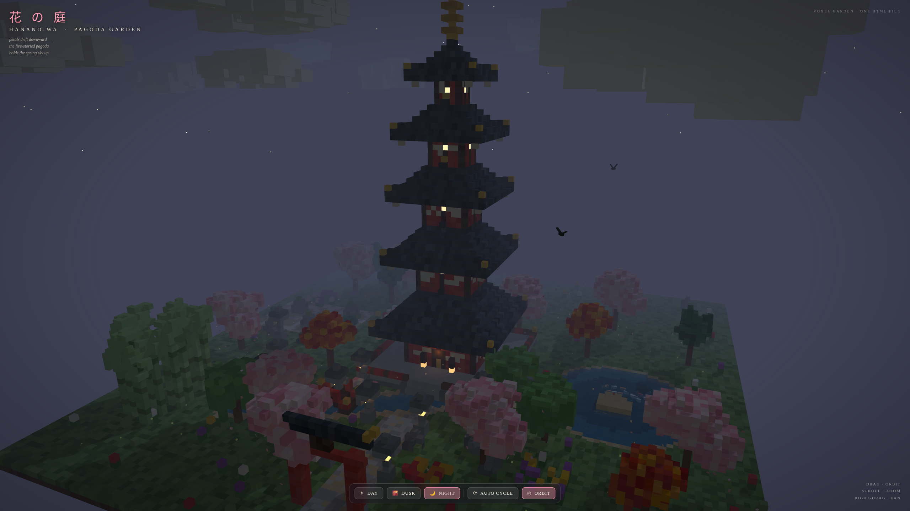
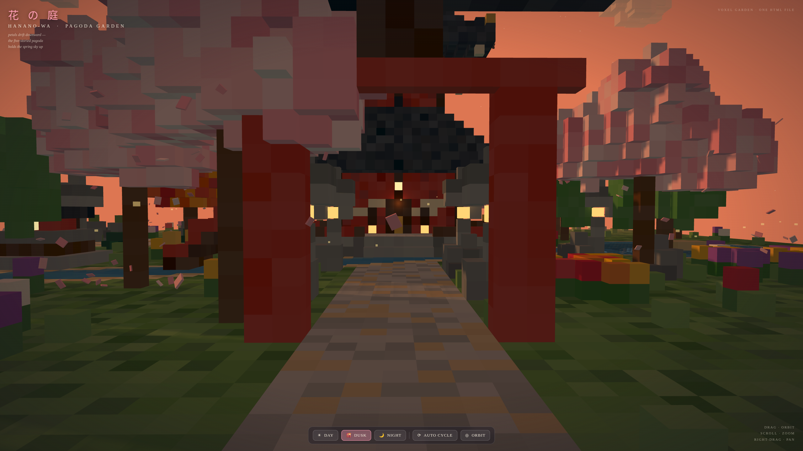
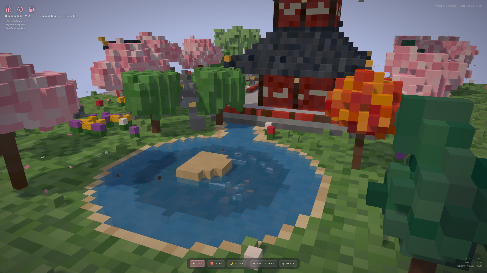

# Qwen3.8-Flash-Next IQ3_S Pagoda Benchmark (Strata)

Voxel pagoda benchmark to test Qwen3.8-Flash-Next running with Strata on a consumer gaming pc.

## Prompt
> Design and create a very creative, elaborate, and detailed voxel art scene of a pagoda in a beautiful garden with trees, including some cherry blossoms. Make the scene impressive and varied and use colorful voxels. Use whatever libraries to get this done but make sure I can paste it all into a single HTML file.

### Hardware used
- NVIDIA RTX 5070
- 64GB DDR5 5200MT/s
- Gen5 NVMe SSD (14GB/s read, 13GB/s write)

## Results
Done in 11m 54s with 65.5 tok/s

